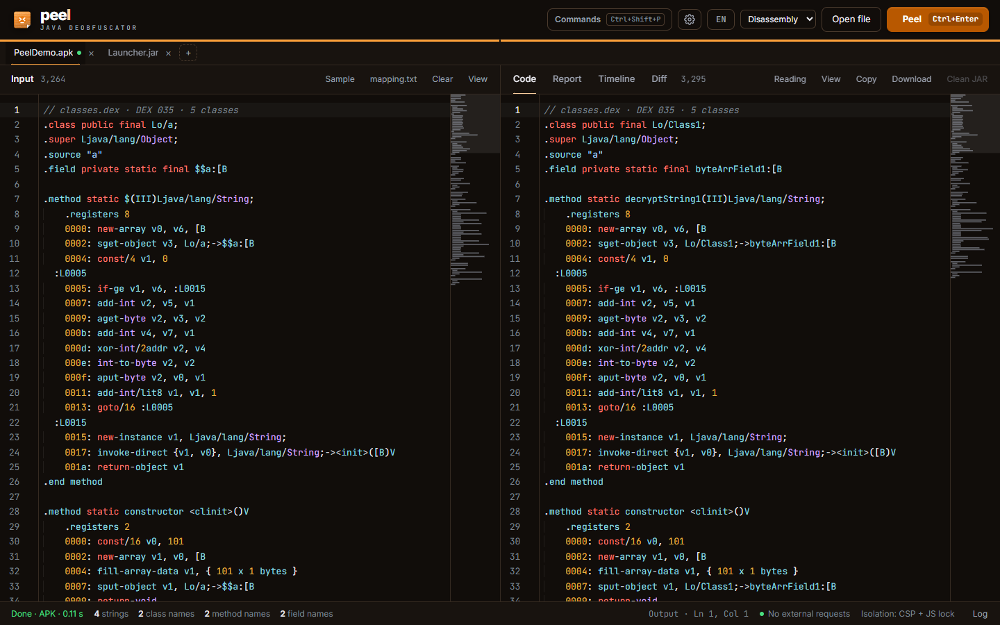
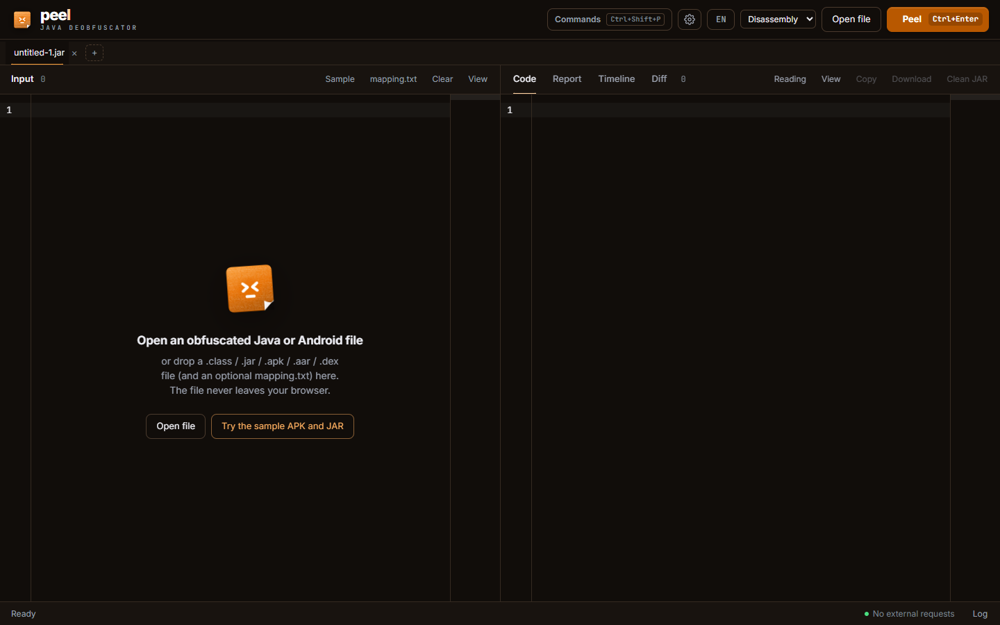
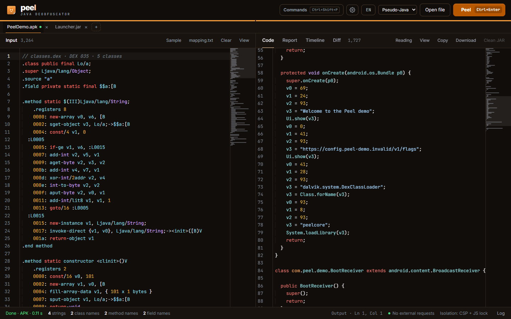
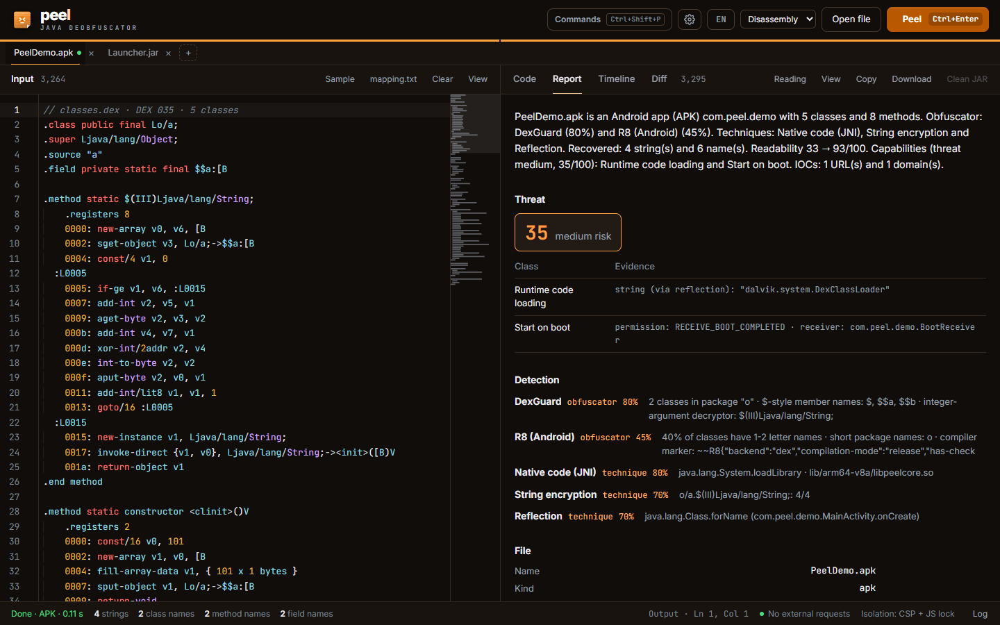
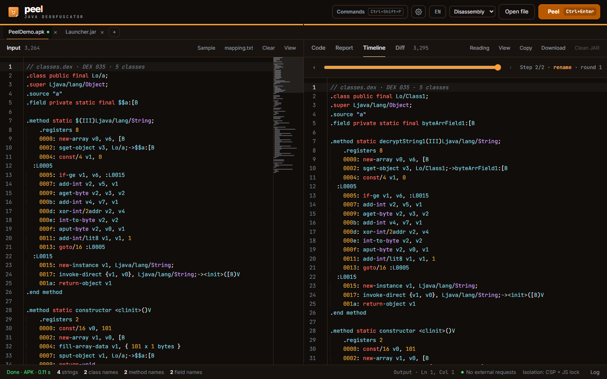
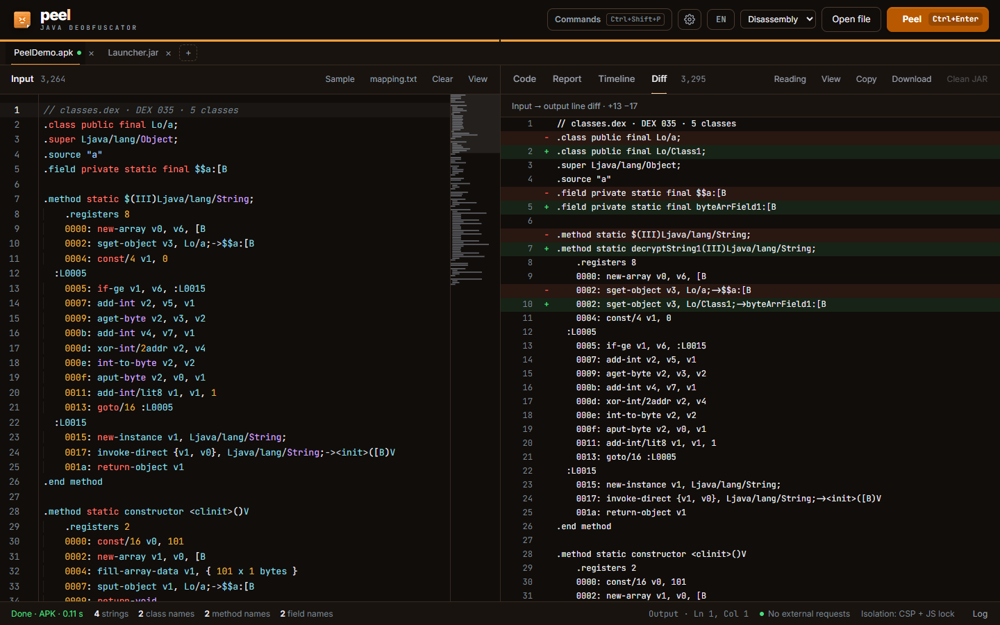
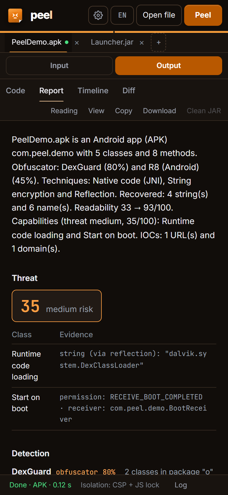
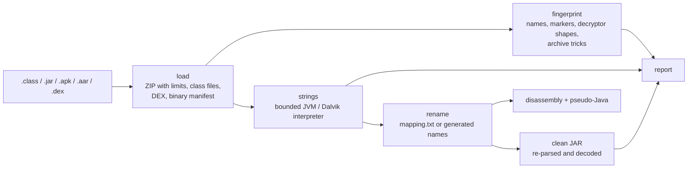

<p align="center">
  <picture>
    <source media="(prefers-color-scheme: dark)" srcset="public/peel-logo-horizontal-dark-1600.png">
    
  </picture>
</p>

<p align="center">
  <b>Peel the obfuscation off Java and Android bytecode, right in your browser.</b><br>
  Open source · MIT · free forever · your files never leave your device
</p>

<p align="center">
  <a href="README.tr.md">Türkçe</a> ·
  <a href="#quick-start">Quick start</a> ·
  <a href="#example">Example</a> ·
  <a href="#features">Features</a> ·
  <a href="#command-line">CLI</a> ·
  <a href="#how-it-works">How it works</a> ·
  <a href="#safety-model">Safety</a> ·
  <a href="#honest-limits">Limits</a>
</p>

<p align="center">
  
</p>

---

## What is PEEL?

PEEL is a Java and Android deobfuscator. Open an obfuscated `.class`, `.jar`, `.apk`, `.aar` or `.dex`, press **Peel**
(`Ctrl + Enter`), and you get a readable disassembly and a pseudo-Java view back, a clean JAR with decrypted strings and
readable names, and a report of what the code does.

Obfuscators such as ProGuard/R8, Allatori, Zelix KlassMaster, Stringer and DexGuard hide a program behind one or two letter
names, encrypted string constants that are only decoded at run time, and archive tricks that confuse tools. PEEL takes those
apart the way an analyst would, without ever running the program:

- **It reads the bytecode itself.** Class files, JAR/AAR archives, APKs, DEX files and the binary `AndroidManifest.xml` are
  parsed in plain JavaScript. A parsed class file is written back byte for byte, so any change PEEL makes is the only change.
- **It runs the decryptors, not the program.** Static decryptor methods (`String f(String)`, `f(int, int, int)`, ZKM's static
  string table, char-array XOR loops...) are executed in a small, bounded interpreter for JVM and Dalvik bytecode that knows
  only arithmetic, arrays, static fields and side-effect-free core APIs (`String`, `StringBuilder`, `Character`, `Integer`,
  `Math`, `System.arraycopy`, `Base64`). A decryptor that reaches anything else is left untouched and reported, with the
  reason.
- **It writes the results back.** In class files every decoded call sequence becomes a single `ldc_w "constant"` padded with
  `nop`, so offsets, branches, `StackMapTable` frames and exception tables stay valid. Names come back from a ProGuard/R8
  `mapping.txt`, or become readable, deterministic placeholders (`Class3`, `ActivityImpl4`, `method12`, `decryptString1`,
  `strField5`). Every class of the clean JAR is parsed again and every method body decoded before you get it.
- **It tells you what the code does.** Detected obfuscator with confidence and evidence, AndroidManifest (package, SDK,
  permissions, exported components), reflection and dynamic code loading (`DexClassLoader`, `Class.forName`), native
  libraries, crypto constants, IOCs (URLs, domains, IPs, e-mails) found in the decrypted strings, a capability score and a
  readability score before and after.
- **It stays on your machine.** No server, no telemetry, no upload. The status bar counts every external request the page
  makes.

One button runs everything.

## Quick start

You need Node.js 25 or newer. There is no Java, JDK or Android SDK requirement.

```bash
git clone https://github.com/LLCForge/Peel-Java.git
cd Peel-Java
npm install
npm run dev
```

Open <http://localhost:5173>, drop a `.class`, `.jar`, `.apk`, `.aar` or `.dex` (and, if you have it, the matching
`mapping.txt`) onto the page or click **Try the sample APK and JAR**, then press **Peel**.

To build a static site you can host anywhere:

```bash
npm run build
```

`dist/` is the whole app, including a `_headers` file with the sandbox CSP for Netlify and Cloudflare Pages. It also works
offline as a PWA after the first visit.

## Screenshots

<table>
  <tr>
    <td width="50%"><br><sub><b>Start screen.</b> Open or drop a file (or a folder, or a mapping.txt), or try the samples.</sub></td>
    <td width="50%"><br><sub><b>Pseudo-Java.</b> Straight-line and simple control flow as Java statements; anything else falls back to bytecode, and says so.</sub></td>
  </tr>
  <tr>
    <td><br><sub><b>Report.</b> Summary, capabilities, detected obfuscator with evidence, manifest, string decryptors, reflection, native libraries, IOCs, crypto, packages, metrics.</sub></td>
    <td><br><sub><b>Timeline.</b> Scrub through the output after every pass.</sub></td>
  </tr>
  <tr>
    <td><br><sub><b>Diff.</b> What changed between the original and the cleaned disassembly.</sub></td>
    <td><br><sub><b>Mobile.</b> The interface also works on a phone.</sub></td>
  </tr>
</table>

The samples in these screenshots are built by [`scripts/make-fixtures.js`](scripts/make-fixtures.js) straight from bytes (no
compiler): `PeelDemo.apk` is a harmless app that imitates DexGuard (an `o` package, `$`-named members, an `(III)String`
decryptor over a static byte table); `Launcher.jar` imitates Allatori (an `ALLATORIxDEMO` decryptor, `IiIiIIiIiI` names). Their
addresses use the reserved `.invalid` domain and the documentation IP range, so they cannot reach anything.

## Example

`PeelDemo.apk`, `MainActivity.onCreate`, as it is in the DEX:

```smali
.method protected onCreate(Landroid/os/Bundle;)V
    .registers 6
    0000: invoke-super {v4, v5}, Landroid/app/Activity;->onCreate(Landroid/os/Bundle;)V
    0003: const/16 v0, 69
    0005: const/16 v1, 24
    0007: const/16 v2, 93
    0009: invoke-static {v0, v1, v2}, Lo/a;->$(III)Ljava/lang/String;
    000c: move-result-object v3
    000d: invoke-static {v3}, Lcom/peel/demo/Ui;->show(Ljava/lang/String;)V
    ...
    0022: invoke-static {v0, v1, v2}, Lo/a;->$(III)Ljava/lang/String;
    0025: move-result-object v3
    0026: invoke-static {v3}, Ljava/lang/Class;->forName(Ljava/lang/String;)Ljava/lang/Class;
    ...
    0030: invoke-static {v0, v1, v2}, Lo/a;->$(III)Ljava/lang/String;
    0033: move-result-object v3
    0034: invoke-static {v3}, Ljava/lang/System;->loadLibrary(Ljava/lang/String;)V
```

What PEEL returns as pseudo-Java, after running `o.a.$` in the Dalvik interpreter for each call site:

```java
protected void onCreate(android.os.Bundle p0) {
    super.onCreate(p0);
    ...
    v3 = "Welcome to the Peel demo";
    Ui.show(v3);
    ...
    v3 = "https://config.peel-demo.invalid/v1/flags";
    Ui.show(v3);
    ...
    v3 = "dalvik.system.DexClassLoader";
    v3 = Class.forName(v3);
    ...
    v3 = "peelcore";
    System.loadLibrary(v3);
    return;
}
```

The report then lists `Class.forName` with a class-loader name as dynamic code loading, `peelcore` next to
`lib/arm64-v8a/libpeelcore.so`, and the URL as an IOC: none of which is visible before the strings are decrypted. For JARs
the same pass rewrites the class files; `Launcher.jar`'s `main` becomes `System.out.println("Peel demo ready");` and so on,
and **Clean JAR** downloads the result.

## Features

### Obfuscators

| Obfuscator | What PEEL does |
|---|---|
| **ProGuard / R8** | detected by short names, `SourceFile` stripping, the `r8-map-id` source name and the `~~R8{...}` DEX marker. With a `mapping.txt` every class, field and method gets its original name back, inherited and interface methods included; without one, readable names are generated. |
| **Allatori** | detected by `ALLATORIxDEMO` / Allatori strings and `iIl` names; the alternating-key XOR string decryptor is executed and every call site replaced. |
| **Zelix KlassMaster** | detected by the `z(String)char[]` / `z(char[])String` pair and the static string table; `<clinit>` runs in the interpreter and every `getstatic z; iconst; aaload` becomes the constant. |
| **Stringer** | detected by static `String f(Object)` decryptors, stack-trace keyed decryptors and custom `invokedynamic` bootstraps. Table-keyed decryptors are decoded; decryptors that need the caller's stack trace are reported as not decodable (the sandbox does not fake a call stack). |
| **DexGuard** | detected by the `o` package, `$`/`$$a`-named members, integer-argument decryptors and DexGuard library names; string decryptors over static byte tables are decoded in the Dalvik interpreter. |
| **Paramorphism** and other archive tricks | duplicate entry names, `Name.class/` directory entries, unparsable class entries and entry/class name mismatches are detected; the clean JAR drops them. Invalid and keyword identifiers (`if`, `do`, Sinhala letters...) are renamed. |
| **Android packers** (360 Jiagu, Bangcle/SecNeo, Tencent Legu, ijiami, Alibaba, Baidu, DexProtector, APKProtect) | detected by their native libraries and reported only: unpacking at run time is out of scope. |

### Passes

| Pass | What it does |
|---|---|
| `strings` | finds calls to static methods inside the input that return `String` and take only constant arguments, and reads of static `String[]` tables with a constant index; runs them in the bounded JVM or Dalvik interpreter (including the owning class's `<clinit>`) and writes the result back as a constant (class files) or marks the call site in the disassembly (DEX). Decryptors that read a static field written outside its own `<clinit>` are not evaluated. Repeats until nothing changes, so nested decryptor calls resolve too. |
| `rename` | applies a ProGuard/R8 `mapping.txt`, or gives unreadable identifiers deterministic names by role and type. Overrides and interface implementations share one name; native methods and their classes, manifest components, `Main-Class`, and names that appear in string constants used through reflection keep theirs. Every reference is rewritten: constant pool, descriptors, generic signatures, `LocalVariableTable`, annotations, `InnerClasses`, `EnclosingMethod`, lambda names, `META-INF/services` and `Main-Class`. |

### Outputs

- **Disassembly**: `javap`-style for class files, smali-style for DEX, with decrypted strings and the new names.
- **Pseudo-Java**: expressions are rebuilt from the operand stack (JVM) or registers (Dalvik); branches are shown as
  `if (...) goto L12;` with labels, loops are not restructured. Values that cross a block boundary are spilled into `s0`,
  `s1`... A method that cannot be expressed this way (too large, `jsr`/`ret`, inconsistent stack) falls back to a bytecode
  listing with a comment that says why.
- **Clean JAR / AAR / .class**: renamed and with decrypted constants; signature files (`.SF`, `.RSA`, `.DSA`, `.EC`) are removed
  because the content changed. **DEX and APK are not rewritten**: decrypted strings and new names are shown in the
  disassembly and pseudo-Java only.

### Analysis report

- **Detection**: obfuscator, packer and techniques (string encryption, reflection, dynamic loading, native code, invokedynamic
  obfuscation, archive tricks) with confidence and evidence.
- **Capabilities**: a 0-100 score with evidence for SMS sending and reading, accessibility services, device admin, overlays,
  runtime code loading, shell commands, root checks, start on boot, Discord/Telegram exfiltration, sensitive permissions,
  installing other apps and emulator detection. It is an indicator, not a verdict.
- **AndroidManifest** (binary XML decoded): package, version, SDK levels, permissions (dangerous ones marked), activities,
  services, receivers and providers with their exported state.
- **String decryptors**: each decryptor with decoded/total call sites and the reason for every one left untouched.
- **Reflection, dynamic loading, native code** with where they are used, **native libraries** (`lib/<abi>/*.so`), **crypto
  constants** (AES S-box, MD5/SHA-1/SHA-256, CRC-32, TEA, FNV, algorithm strings, `javax.crypto` use), **packages**, **IOCs**
  and a **readability score** (0-100) before and after.

### Interface

The same interface as the other PEEL tools: tabs and folders, a CodeMirror editor with highlighting, folding, search and a
minimap, report, timeline and diff views, a command palette, shortcuts, light/dark/high-contrast themes, colour-blind
palettes, Turkish and English, sessions stored in IndexedDB (export and import as JSON), offline PWA, and a mobile layout. A
`mapping.txt` dropped on the page, or loaded with the **mapping.txt** button, is attached to the current tab.

## Command line

```bash
npx peel-java app.jar                         # disassembly to stdout, summary to stderr
npx peel-java app.jar --view java -o app.java.txt -j app.clean.jar -r report.json
npx peel-java app.jar -m mapping.txt -j app.clean.jar
npx peel-java app.apk -r text --lang en       # text report to stdout
npx peel-java samples/ -d out/ -r reports.json
npx peel-java - --json < app.dex              # stdin, JSON report to stdout
npx peel-java app.apk --fail-on high          # exit code 4 when the capability level is high or critical
```

| Option | Meaning |
|---|---|
| `-o, --out <file>` | write the output to a file |
| `-d, --out-dir <dir>` | write outputs (and clean archives) for a directory input, structure kept |
| `-j, --jar <file>` | write the clean JAR / AAR / class file (not for APK/DEX) |
| `-m, --mapping <file>` | restore original names from a ProGuard/R8 `mapping.txt` |
| `--view disasm\|java` | disassembly (default) or pseudo-Java |
| `-r, --report <json\|text\|file>` | report to stdout or to a file (`.txt` gives text) |
| `--only <pass,...>` | run only these passes (`strings`, `rename`) |
| `--lang tr\|en` | report language |
| `--fail-on <level>` | exit code 4 when the capability level reaches `low`, `medium`, `high` or `critical` |

Exit codes: 0 ok, 1 error, 2 usage error, 4 threshold reached.

## Library

```js
import { peel, deobfuscate, analyze } from 'peel-java';
import { readFileSync, writeFileSync } from 'node:fs';

const r = await peel(readFileSync('app.jar'), { name: 'app.jar', mapping: readFileSync('mapping.txt', 'utf8'), lang: 'en' });
console.log(r.report.summary);
writeFileSync('app.disasm.txt', r.code);   // disassembly
writeFileSync('app.java.txt', r.java);     // pseudo-Java
if (r.bytes) writeFileSync(`app.clean${r.ext}`, r.bytes);   // clean JAR / AAR / class (null for APK/DEX)
```

`deobfuscate()` returns the same without the report. The library runs the pipeline in the calling thread; the CLI runs it in an
isolated child process with a watchdog (see below). The report format is documented at the top of
[`src/core/analyze.js`](src/core/analyze.js).

## How it works



| Folder | Contents |
|---|---|
| `src/core/` | ZIP reader, input loader, pipeline, ProGuard mapping parser, rewriter, limits, report assembly |
| `src/jvm/` | class file reader/writer, opcode decoder, JVM interpreter, `javap`-style disassembler, pseudo-Java |
| `src/dex/` | DEX reader, Dalvik opcode decoder, Dalvik interpreter, binary XML decoder, smali view and pseudo-Java |
| `src/passes/` | string decryption and renaming |
| `src/sandbox/` | the side-effect-free Java runtime subset, watchdog, Web Worker and Node hosts |
| `src/report/` | fingerprints, capability rules, IOCs, facts (crypto, reflection, packages), summary, text report |
| `src/ui/` | the web interface |
| `src/cli/`, `bin/` | the CLI |
| `scripts/` | fixture generator: a small class file assembler, a DEX writer, a binary XML writer and the harmless samples |
| `test/` | fixtures, unit tests, benchmark |

**Choice of tooling.** There are excellent JVM-side tools (ASM, dex2jar, JADX, smali, Recaf), but they need a Java runtime
and cannot run in a browser tab. PEEL needs to read and rewrite class files, read DEX, and execute small pieces of bytecode
under strict limits; doing that in about 5 000 lines of dependency-free JavaScript keeps the whole thing in a single static
page and a single npm package. The only runtime dependency of the engine is [fflate](https://github.com/101arrowz/fflate) (MIT)
for deflate; the interface uses CodeMirror (MIT). The test fixtures are assembled from bytes by the project's own generator,
so neither a JDK nor the Android SDK is needed to build or test. If `javap` is on the `PATH`, `npm run fixtures` also reads a
generated class with it as an extra check.

## Safety model

PEEL never runs the program it analyses. The only code it evaluates is the body of static decryptor methods, and only in its
own interpreter:

- **A tiny runtime.** The interpreter supports arithmetic, arrays, static fields of classes inside the input (with their
  `<clinit>`), static calls inside the input, and an allow-list of pure core methods (`String`, `StringBuilder`,
  `StringBuffer`, `Character`, `Integer`, `Math`, `System.arraycopy`, `java.util.Base64`, `android.util.Base64`). There is no
  reflection, no class loading, no I/O, no threads, no clock, no randomness, no native code and no object instances of input
  classes. Anything else stops the evaluation and the call site stays as it is.
- **Budgets everywhere.** 2 000 000 instructions, 48 call levels, 8 M array/string elements and 1.5 s per call; 20 s for the
  whole string pass; 128 MB input, 64 MB per archive entry, 512 MB in total, a compression ratio cap (zip bombs), 50 000
  entries, 40 000 classes, nested archives one level deep, 64 KB method bodies and 65 535 constant pool entries
  ([`src/core/limits.js`](src/core/limits.js)). Every reader is bounds-checked.
- **Node (CLI and tests).** The pipeline runs in a child process started with `node --permission` that may read only `src/`
  and fflate; file writes, network, child processes and workers are denied by the runtime. A watchdog kills a process that
  misses its deadline and starts a new one for the next request.
- **Browser.** The pipeline runs in a Web Worker with its own Content Security Policy from the response header
  (`default-src 'none'; script-src 'self'; connect-src 'self'`). Before the first message the worker removes `fetch`,
  `XMLHttpRequest`, `WebSocket`, `EventSource`, `WebTransport`, `importScripts`, nested workers, `caches`, `indexedDB`,
  `BroadcastChannel`, `eval`, the `Function` constructors and string timers. The status bar shows which layers are active;
  **Stop** terminates the worker.

## Honest limits

- **DEX and APK are not rewritten.** Decrypted strings and new names appear in the smali view, the pseudo-Java and the report;
  there is no DEX writer.
- **Pseudo-Java is not a decompiler.** Control flow is shown with labels and `goto`; there are no `if`/`while` blocks, no
  type inference for locals and no generics. For full decompilation feed the clean JAR to a decompiler.
- **Only static decryptors with constant arguments are evaluated.** Decryptors that use instance state, reflection, the call
  stack (some Stringer and DexGuard modes), class-loader resources, native code or a key set at run time are reported and left
  in place. Strings encrypted with real cryptography (`javax.crypto`) are not decoded.
- **Generated names are placeholders.** Without a `mapping.txt` the original names are gone; PEEL keeps package names (so
  package-private access stays valid) and only renames identifiers that look obfuscated. A method that overrides a library
  method with an obfuscated-looking name would be renamed; ProGuard and R8 never produce that.
- **Reflection keeps names conservatively.** If the input uses reflection, member names that appear as string constants keep
  their names; class names that appear in strings always do. Names built at run time are not tracked.
- **Fingerprints are heuristics.** The samples in this repository imitate each obfuscator's known patterns; real commercial
  obfuscators (Allatori, ZKM, Stringer, DexGuard) are not shipped or run in the tests, so their newer modes may be detected with
  lower confidence or not at all. Type annotations (`RuntimeVisibleTypeAnnotations`) and Kotlin metadata are not remapped.
- **Packers are not unpacked**, and encrypted `classes.dex` payloads inside assets are not decrypted.
- Signed JARs lose their signature when rewritten (the signature files are removed).

## Tests

```bash
npm test                    # 9 fixtures through the whole pipeline, then 10 unit test files (about 8 s)
node test/run.js zkm        # one fixture with its log and summary (add --code or --java for the output)
npm run fixtures            # rebuild the fixtures and the UI samples (deterministic)
npm run bench               # synthetic large inputs
```

The fixtures are harmless programs written as bytes by [`scripts/make-fixtures.js`](scripts/make-fixtures.js): a plain class,
a ProGuard/R8 JAR with and without its `mapping.txt`, Allatori-, ZKM- and Stringer-style JARs, a DexGuard-style APK with a
binary manifest and a native library, a Paramorphism-style JAR with archive tricks, and an AAR with an inner `classes.jar`.
Each fixture's expectations (strings that must appear in the disassembly and the pseudo-Java, detections, decrypted and
untouched call sites, entries of the clean archive, manifest permissions, capabilities) are in the `.json` next to it, and
every clean archive is fed back through PEEL. The unit tests cover byte-for-byte class file round trips, MUTF-8, DEX tables and
payloads, binary XML, every decryptor against its encoder, Java arithmetic semantics in both interpreters, mapping parsing and
application with a reference consistency check of the clean JAR, every fingerprint, the capability and IOC rules, zip bombs,
corrupt headers, instruction/depth/memory budgets, 160 randomly corrupted inputs, the CLI, the worker path and CSP, the Node
sandbox (permission model, watchdog) and translation key parity.

Measured on the developer machine (Node 25, Windows, x64) with `npm run bench`:

| Input | Size | Classes | Strings decoded | Names | Time (median of 3) |
|---|---|---|---|---|---|
| JAR, 1 000 classes × 10 decryptor calls | 447 KB | 1 001 | 10 000 / 10 000 | 5 002 | 813 ms |
| JAR, 5 000 classes × 4 decryptor calls | 1 945 KB | 5 001 | 20 000 / 20 000 | 25 002 | 4 451 ms |
| APK, 2 000 classes × 10 decryptor calls | 35 KB | 2 001 | 20 000 / 20 000 | 4 003 | 379 ms |

## Contributing

Issues and pull requests are welcome. If you have a file PEEL does not handle, please open an issue with a small, harmless
program that reproduces it; the fixture generator in `scripts/lib/` can usually express the pattern in a few lines, and a pull
request that adds a fixture proving the fix is the fastest way to get it merged. Please do not attach real malware or
third-party commercial software.

## License

[MIT](LICENSE). Free to use, change and redistribute, including commercially. There is no paid tier, no account and no
telemetry. Third-party components keep their own licences: fflate (MIT), CodeMirror (MIT), Inter and JetBrains Mono (OFL).
