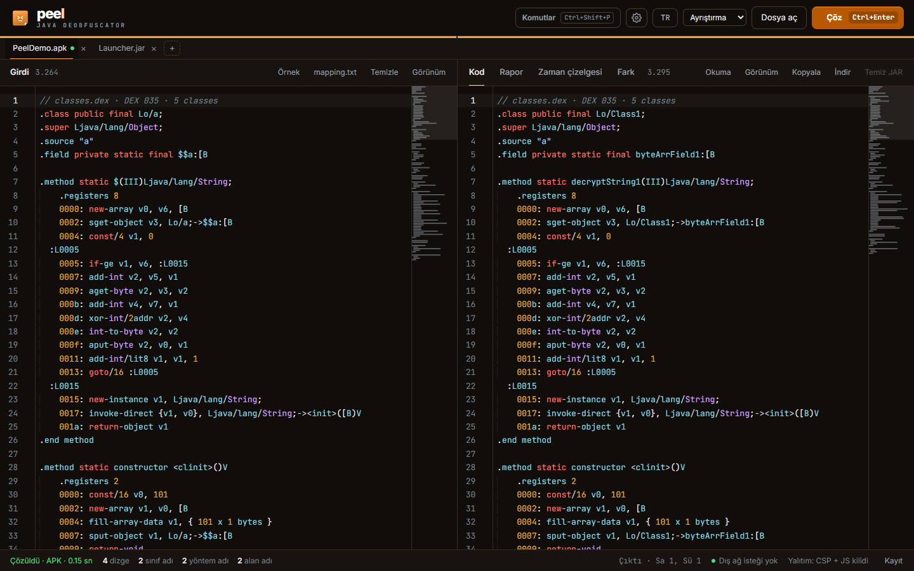
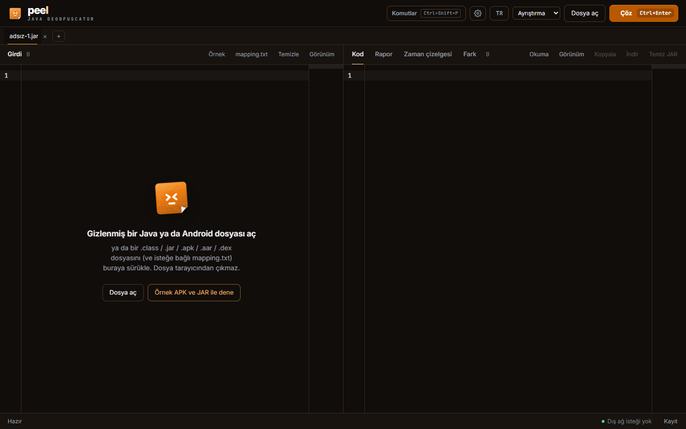
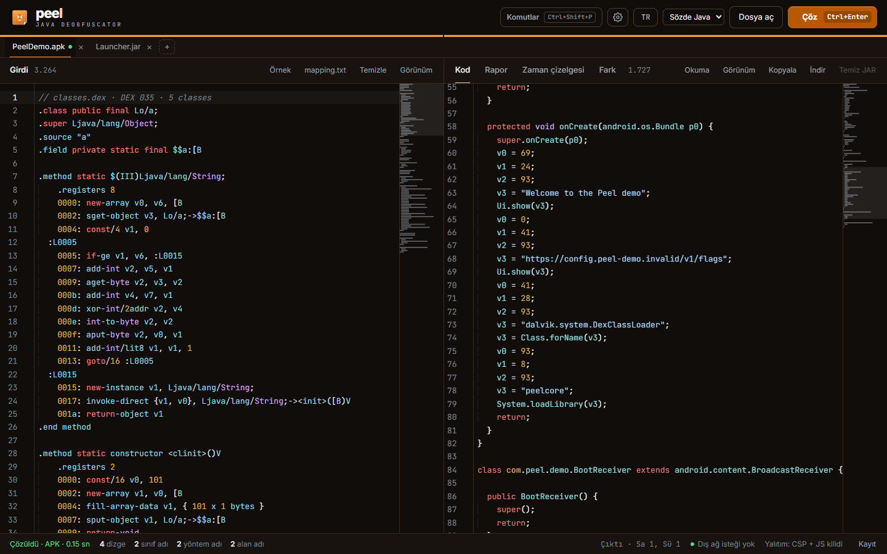
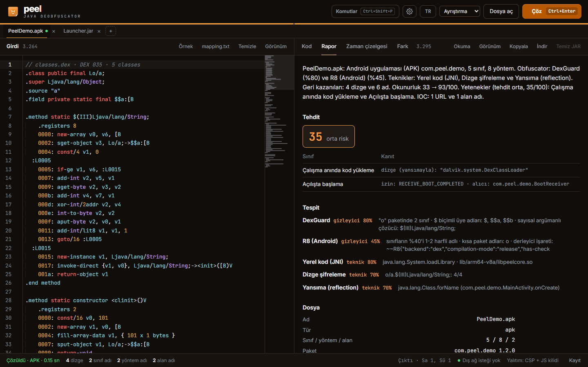
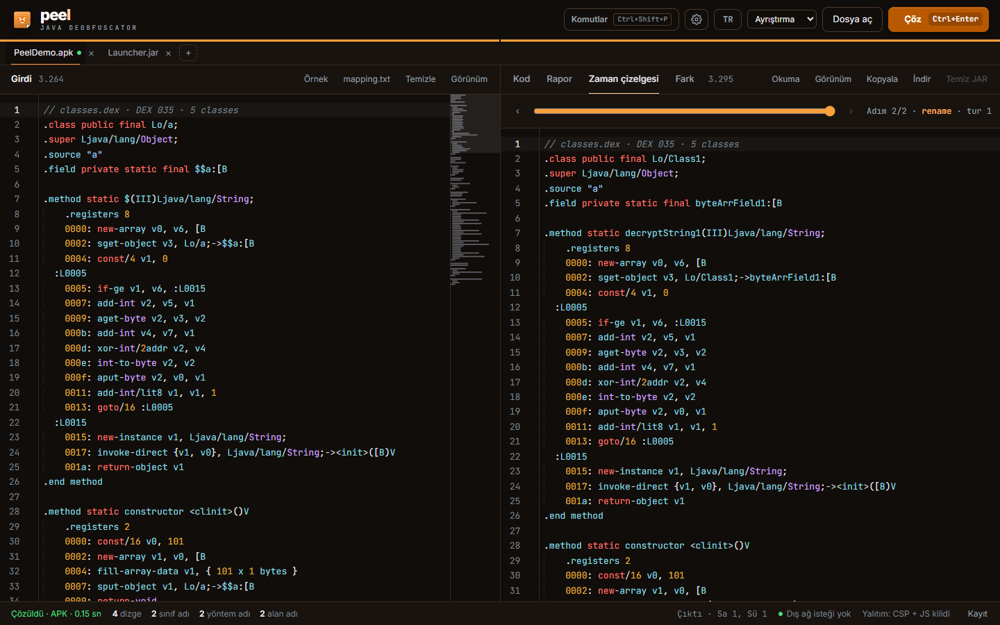
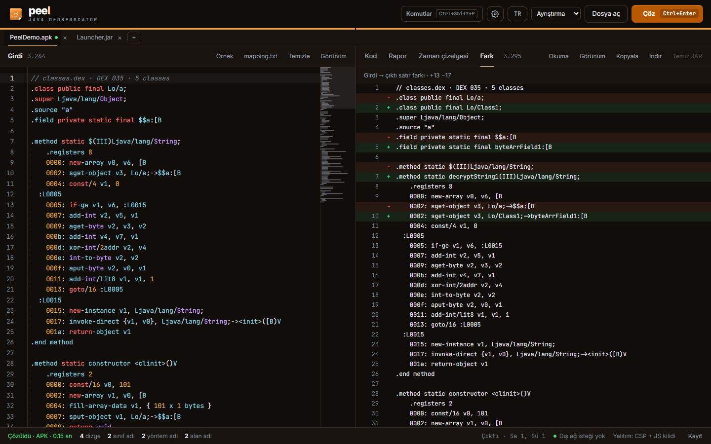
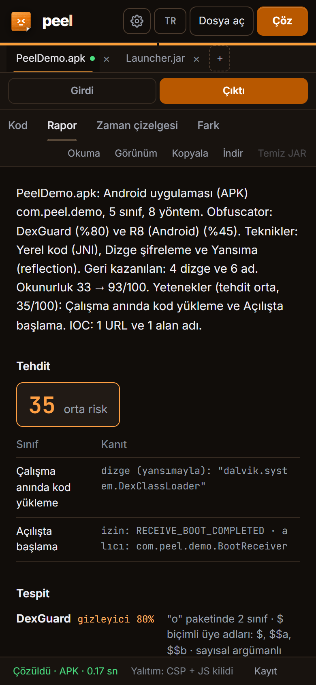
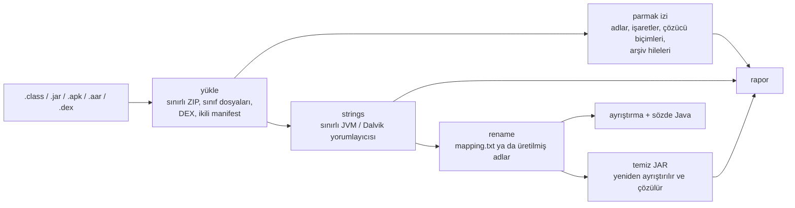

<p align="center">
  <picture>
    <source media="(prefers-color-scheme: dark)" srcset="public/peel-logo-horizontal-dark-1600.png">
    
  </picture>
</p>

<p align="center">
  <b>Java ve Android bytecode'undaki gizlemeyi doğrudan tarayıcında soy.</b><br>
  Açık kaynak · MIT · sonsuza dek ücretsiz · dosyaların cihazından çıkmaz
</p>

<p align="center">
  <a href="README.md">English</a> ·
  <a href="#hızlı-başlangıç">Hızlı başlangıç</a> ·
  <a href="#örnek">Örnek</a> ·
  <a href="#özellikler">Özellikler</a> ·
  <a href="#komut-satırı">CLI</a> ·
  <a href="#nasıl-çalışır">Nasıl çalışır</a> ·
  <a href="#güvenlik-modeli">Güvenlik</a> ·
  <a href="#dürüst-sınırlar">Sınırlar</a>
</p>

<p align="center">
  
</p>

---

## PEEL nedir?

PEEL bir Java ve Android deobfuscator'ıdır. Gizlenmiş bir `.class`, `.jar`, `.apk`, `.aar` ya da `.dex` dosyasını aç,
**Çöz**'e bas (`Ctrl + Enter`); okunur bir ayrıştırma ve sözde Java görünümü, dizgeleri çözülmüş ve adları okunur hâle
getirilmiş temiz bir JAR ve kodun ne yaptığını anlatan bir rapor geri alırsın.

ProGuard/R8, Allatori, Zelix KlassMaster, Stringer ve DexGuard gibi gizleyiciler programı bir iki harflik adların, yalnızca
çalışma anında çözülen şifreli dizge sabitlerinin ve araçları şaşırtan arşiv hilelerinin arkasına saklar. PEEL bunları bir
analistin yapacağı gibi söker, ama programı hiçbir zaman çalıştırmaz:

- **Bytecode'u kendisi okur.** Sınıf dosyaları, JAR/AAR arşivleri, APK'lar, DEX dosyaları ve ikili `AndroidManifest.xml`
  düz JavaScript ile ayrıştırılır. Ayrıştırılan bir sınıf dosyası bayt bayt aynı geri yazılır; yani PEEL'in yaptığı değişiklik
  tek değişikliktir.
- **Programı değil çözücüleri çalıştırır.** Statik çözücü yöntemler (`String f(String)`, `f(int, int, int)`, ZKM'nin statik
  dizge tablosu, char dizisi XOR döngüleri...) JVM ve Dalvik bytecode'u için küçük, sınırlı bir yorumlayıcıda çalıştırılır.
  Yorumlayıcı yalnızca aritmetiği, dizileri, statik alanları ve yan etkisiz çekirdek API'leri (`String`, `StringBuilder`,
  `Character`, `Integer`, `Math`, `System.arraycopy`, `Base64`) bilir. Başka bir şeye ulaşan çözücüye dokunulmaz; nedeniyle
  birlikte raporlanır.
- **Sonuçları geri yazar.** Sınıf dosyalarında çözülen her çağrı dizisi `nop` ile doldurulmuş tek bir `ldc_w "sabit"` olur;
  konumlar, dallar, `StackMapTable` çerçeveleri ve istisna tabloları geçerli kalır. Adlar ProGuard/R8 `mapping.txt`'den geri
  gelir ya da okunur, belirlenimci yer tutuculara dönüşür (`Class3`, `ActivityImpl4`, `method12`, `decryptString1`,
  `strField5`). Temiz JAR'daki her sınıf, sana verilmeden önce yeniden ayrıştırılır ve her yöntem gövdesi çözülür.
- **Kodun ne yaptığını söyler.** Güven ve kanıtla tanınan gizleyici, AndroidManifest (paket, SDK, izinler, dışa açık
  bileşenler), yansıma ve dinamik kod yükleme (`DexClassLoader`, `Class.forName`), yerel kütüphaneler, kripto sabitleri,
  çözülmüş dizgelerde bulunan IOC'ler (URL, alan adı, IP, e-posta), bir yetenek puanı ve öncesi/sonrası okunurluk puanı.
- **Senin makinende kalır.** Sunucu yok, telemetri yok, yükleme yok. Durum çubuğu sayfanın yaptığı her dış isteği sayar.

Her şeyi tek bir düğme çalıştırır.

## Hızlı başlangıç

Node.js 25 ya da üstü gerekir. Java, JDK ya da Android SDK gerekmez.

```bash
git clone https://github.com/LLCForge/Peel-Java.git
cd Peel-Java
npm install
npm run dev
```

<http://localhost:5173> adresini aç; bir `.class`, `.jar`, `.apk`, `.aar` ya da `.dex` dosyasını (varsa eşleşen
`mapping.txt` ile birlikte) sayfaya bırak ya da **Örnek APK ve JAR ile dene**'ye tıkla, sonra **Çöz**'e bas.

Her yerde barındırabileceğin statik bir site için:

```bash
npm run build
```

`dist/` uygulamanın tamamıdır; Netlify ve Cloudflare Pages için sandbox CSP'sini içeren bir `_headers` dosyası da vardır.
İlk ziyaretten sonra PWA olarak çevrimdışı da çalışır.

## Ekran görüntüleri

<table>
  <tr>
    <td width="50%"><br><sub><b>Başlangıç.</b> Bir dosya (ya da klasör, ya da mapping.txt) aç veya bırak; ya da örnekleri dene.</sub></td>
    <td width="50%"><br><sub><b>Sözde Java.</b> Düz akış ve basit dallar Java deyimi olarak; gerisi bytecode'a düşer ve bunu söyler.</sub></td>
  </tr>
  <tr>
    <td><br><sub><b>Rapor.</b> Özet, yetenekler, kanıtlı gizleyici tespiti, manifest, dizge çözücüler, yansıma, yerel kütüphaneler, IOC, kripto, paketler, ölçüler.</sub></td>
    <td><br><sub><b>Zaman çizelgesi.</b> Her geçişten sonraki çıktıda gezin.</sub></td>
  </tr>
  <tr>
    <td><br><sub><b>Fark.</b> Özgün ve temizlenmiş ayrıştırma arasında ne değişti.</sub></td>
    <td><br><sub><b>Mobil.</b> Arayüz telefonda da çalışır.</sub></td>
  </tr>
</table>

Ekran görüntülerindeki örnekler, derleyici olmadan doğrudan bayt olarak [`scripts/make-fixtures.js`](scripts/make-fixtures.js)
ile üretilir: `PeelDemo.apk`, DexGuard'ı taklit eden zararsız bir uygulamadır (`o` paketi, `$` adlı üyeler, statik bayt
tablosu üzerinde `(III)String` çözücü); `Launcher.jar` Allatori'yi taklit eder (`ALLATORIxDEMO` çözücüsü, `IiIiIIiIiI` adları).
Adresleri ayrılmış `.invalid` alan adını ve belgeleme IP aralığını kullanır; hiçbir yere ulaşamazlar.

## Örnek

`PeelDemo.apk`, `MainActivity.onCreate`, DEX'te olduğu gibi:

```smali
.method protected onCreate(Landroid/os/Bundle;)V
    .registers 6
    0000: invoke-super {v4, v5}, Landroid/app/Activity;->onCreate(Landroid/os/Bundle;)V
    0003: const/16 v0, 69
    0005: const/16 v1, 24
    0007: const/16 v2, 93
    0009: invoke-static {v0, v1, v2}, Lo/a;->$(III)Ljava/lang/String;
    000c: move-result-object v3
    000d: invoke-static {v3}, Lcom/peel/demo/Ui;->show(Ljava/lang/String;)V
    ...
    0022: invoke-static {v0, v1, v2}, Lo/a;->$(III)Ljava/lang/String;
    0025: move-result-object v3
    0026: invoke-static {v3}, Ljava/lang/Class;->forName(Ljava/lang/String;)Ljava/lang/Class;
    ...
    0030: invoke-static {v0, v1, v2}, Lo/a;->$(III)Ljava/lang/String;
    0033: move-result-object v3
    0034: invoke-static {v3}, Ljava/lang/System;->loadLibrary(Ljava/lang/String;)V
```

PEEL'in her çağrı yeri için `o.a.$` yöntemini Dalvik yorumlayıcısında çalıştırdıktan sonra döndürdüğü sözde Java:

```java
protected void onCreate(android.os.Bundle p0) {
    super.onCreate(p0);
    ...
    v3 = "Welcome to the Peel demo";
    Ui.show(v3);
    ...
    v3 = "https://config.peel-demo.invalid/v1/flags";
    Ui.show(v3);
    ...
    v3 = "dalvik.system.DexClassLoader";
    v3 = Class.forName(v3);
    ...
    v3 = "peelcore";
    System.loadLibrary(v3);
    return;
}
```

Rapor bundan sonra sınıf yükleyici adıyla yapılan `Class.forName` çağrısını dinamik kod yükleme olarak, `peelcore`'u
`lib/arm64-v8a/libpeelcore.so` ile birlikte, URL'yi de IOC olarak listeler; dizgeler çözülmeden önce bunların hiçbiri
görünmez. JAR'larda aynı geçiş sınıf dosyalarını yeniden yazar; `Launcher.jar`'ın `main`'i
`System.out.println("Peel demo ready");` vb. olur ve **Temiz JAR** sonucu indirir.

## Özellikler

### Gizleyiciler

| Gizleyici | PEEL ne yapar |
|---|---|
| **ProGuard / R8** | kısa adlardan, silinmiş `SourceFile`'dan, `r8-map-id` kaynak adından ve `~~R8{...}` DEX işaretinden tanınır. `mapping.txt` verilirse her sınıf, alan ve yöntem (miras alınan ve arayüz yöntemleri dahil) özgün adını geri alır; verilmezse okunur adlar üretilir. |
| **Allatori** | `ALLATORIxDEMO` / Allatori dizgeleri ve `iIl` adlarından tanınır; iki anahtarı sırayla kullanan XOR çözücüsü çalıştırılır ve her çağrı yeri değiştirilir. |
| **Zelix KlassMaster** | `z(String)char[]` / `z(char[])String` çiftinden ve statik dizge tablosundan tanınır; `<clinit>` yorumlayıcıda çalışır ve her `getstatic z; iconst; aaload` sabite dönüşür. |
| **Stringer** | statik `String f(Object)` çözücülerden, yığın izine bağlı çözücülerden ve özel `invokedynamic` önyükleyicilerinden tanınır. Tablo anahtarlı çözücüler çözülür; çağıranın yığın izine ihtiyaç duyan çözücüler çözülemez olarak raporlanır (sandbox sahte çağrı yığını üretmez). |
| **DexGuard** | `o` paketinden, `$`/`$$a` adlı üyelerden, tamsayı argümanlı çözücülerden ve DexGuard kütüphane adlarından tanınır; statik bayt tabloları üzerindeki dizge çözücüleri Dalvik yorumlayıcısında çözülür. |
| **Paramorphism** ve diğer arşiv hileleri | aynı adlı kayıtlar, `Ad.class/` dizin kayıtları, ayrıştırılamayan sınıf kayıtları ve kayıt/sınıf adı uyuşmazlıkları tanınır; temiz JAR bunları içermez. Geçersiz ve anahtar sözcük adlar (`if`, `do`, Sinhala harfleri...) yeniden adlandırılır. |
| **Android paketleyicileri** (360 Jiagu, Bangcle/SecNeo, Tencent Legu, ijiami, Alibaba, Baidu, DexProtector, APKProtect) | yerel kütüphanelerinden tanınır ve yalnızca raporlanır: çalışma anında paket açmak kapsam dışıdır. |

### Geçişler

| Geçiş | Ne yapar |
|---|---|
| `strings` | girdideki, `String` döndüren ve yalnızca sabit argüman alan statik yöntemlere yapılan çağrıları ve statik `String[]` tablolarından sabit indisle okumaları bulur; bunları sınırlı JVM ya da Dalvik yorumlayıcısında (sahip sınıfın `<clinit>`'i dahil) çalıştırır ve sonucu sabit olarak geri yazar (sınıf dosyaları) ya da çağrı yerini ayrıştırmada işaretler (DEX). Kendi `<clinit>`'i dışında yazılan bir statik alanı okuyan çözücü değerlendirilmez. Değişiklik durana kadar tekrarlanır; iç içe çözücü çağrıları da çözülür. |
| `rename` | ProGuard/R8 `mapping.txt`'yi uygular ya da okunaksız tanımlayıcılara rolüne ve türüne göre belirlenimci adlar verir. Geçersiz kılan yöntemler ve arayüz uygulamaları tek ad paylaşır; native yöntemler ve sınıfları, manifest bileşenleri, `Main-Class` ve yansımayla kullanılan dizge sabitlerinde geçen adlar korunur. Her başvuru yeniden yazılır: sabit havuzu, tanımlayıcılar, genel imzalar, `LocalVariableTable`, açıklamalar, `InnerClasses`, `EnclosingMethod`, lambda adları, `META-INF/services` ve `Main-Class`. |

### Çıktılar

- **Ayrıştırma**: sınıf dosyaları için `javap` benzeri, DEX için smali benzeri; çözülmüş dizgeler ve yeni adlarla.
- **Sözde Java**: ifadeler işlenen yığınından (JVM) ya da yazmaçlardan (Dalvik) yeniden kurulur; dallar etiketli
  `if (...) goto L12;` olarak gösterilir, döngüler yeniden yapılandırılmaz. Blok sınırını aşan değerler `s0`, `s1`...
  değişkenlerine dökülür. Bu biçimde gösterilemeyen yöntem (çok büyük, `jsr`/`ret`, tutarsız yığın) nedenini söyleyen bir
  yorumla bytecode listesine düşer.
- **Temiz JAR / AAR / .class**: yeniden adlandırılmış ve sabitleri çözülmüş; içerik değiştiği için imza dosyaları (`.SF`,
  `.RSA`, `.DSA`, `.EC`) çıkarılır. **DEX ve APK yeniden yazılmaz**: çözülmüş dizgeler ve yeni adlar yalnızca ayrıştırmada ve
  sözde Java'da gösterilir.

### Analiz raporu

- **Tespit**: gizleyici, paketleyici ve teknikler (dizge şifreleme, yansıma, dinamik yükleme, yerel kod, invokedynamic
  gizleme, arşiv hileleri), güven ve kanıtla.
- **Yetenekler**: kanıtlı 0-100 puan; SMS gönderme ve okuma, erişilebilirlik hizmetleri, cihaz yöneticisi, üstte pencere,
  çalışma anında kod yükleme, kabuk komutları, root denetimi, açılışta başlama, Discord/Telegram sızdırma, hassas izinler,
  başka uygulama kurma ve emülatör tespiti. Bu bir göstergedir, hüküm değildir.
- **AndroidManifest** (ikili XML çözülür): paket, sürüm, SDK düzeyleri, izinler (tehlikeliler işaretli), etkinlikler,
  hizmetler, alıcılar ve sağlayıcılar ile dışa açık olup olmadıkları.
- **Dizge çözücüler**: her çözücü için çözülen/toplam çağrı yeri ve dokunulmayan her yerin nedeni.
- Kullanıldıkları yerle birlikte **yansıma, dinamik yükleme, yerel kod**, **yerel kütüphaneler** (`lib/<abi>/*.so`), **kripto
  sabitleri** (AES S-kutusu, MD5/SHA-1/SHA-256, CRC-32, TEA, FNV, algoritma dizgeleri, `javax.crypto` kullanımı), **paketler**,
  **IOC'ler** ve öncesi/sonrası **okunurluk puanı** (0-100).

### Arayüz

Diğer PEEL araçlarıyla aynı arayüz: sekmeler ve klasörler, vurgulama, katlama, arama ve mini haritalı CodeMirror editörü,
rapor, zaman çizelgesi ve fark görünümleri, komut paleti, kısayollar, açık/koyu/yüksek kontrast temalar, renk körlüğü
paletleri, Türkçe ve İngilizce, IndexedDB'de saklanan oturumlar (JSON olarak dışa/içe aktarma), çevrimdışı PWA ve mobil
düzen. Sayfaya bırakılan ya da **mapping.txt** düğmesiyle yüklenen `mapping.txt` etkin sekmeye bağlanır.

## Komut satırı

```bash
npx peel-java app.jar                         # ayrıştırma stdout'a, özet stderr'e
npx peel-java app.jar --view java -o app.java.txt -j app.clean.jar -r rapor.json
npx peel-java app.jar -m mapping.txt -j app.clean.jar
npx peel-java app.apk -r text                 # metin rapor stdout'a
npx peel-java ornekler/ -d cikti/ -r raporlar.json
npx peel-java - --json < app.dex              # stdin, JSON rapor stdout'a
npx peel-java app.apk --fail-on high          # yetenek düzeyi yüksek ya da kritikse çıkış kodu 4
```

| Seçenek | Anlamı |
|---|---|
| `-o, --out <dosya>` | çıktıyı dosyaya yaz |
| `-d, --out-dir <dizin>` | dizin girdisinde çıktıları (ve temiz arşivleri) yapıyı koruyarak yaz |
| `-j, --jar <dosya>` | temiz JAR / AAR / sınıf dosyasını yaz (APK/DEX için yok) |
| `-m, --mapping <dosya>` | ProGuard/R8 `mapping.txt` ile özgün adları geri koy |
| `--view disasm\|java` | ayrıştırma (varsayılan) ya da sözde Java |
| `-r, --report <json\|text\|dosya>` | rapor stdout'a ya da dosyaya (`.txt` metin verir) |
| `--only <geçiş,...>` | yalnızca bu geçişler (`strings`, `rename`) |
| `--lang tr\|en` | rapor dili |
| `--fail-on <düzey>` | yetenek düzeyi `low`, `medium`, `high` ya da `critical` eşiğine ulaşırsa çıkış kodu 4 |

Çıkış kodları: 0 tamam, 1 hata, 2 kullanım hatası, 4 eşiğe ulaşıldı.

## Kütüphane

```js
import { peel, deobfuscate, analyze } from 'peel-java';
import { readFileSync, writeFileSync } from 'node:fs';

const r = await peel(readFileSync('app.jar'), { name: 'app.jar', mapping: readFileSync('mapping.txt', 'utf8'), lang: 'tr' });
console.log(r.report.summary);
writeFileSync('app.disasm.txt', r.code);   // ayrıştırma
writeFileSync('app.java.txt', r.java);     // sözde Java
if (r.bytes) writeFileSync(`app.clean${r.ext}`, r.bytes);   // temiz JAR / AAR / sınıf (APK/DEX için null)
```

`deobfuscate()` aynısını raporsuz döndürür. Kütüphane hattı çağıran thread'de çalıştırır; CLI ise bekçili, yalıtılmış bir
alt süreçte çalıştırır (aşağıya bakın). Rapor biçimi [`src/core/analyze.js`](src/core/analyze.js) dosyasının başında
belgelenmiştir.

## Nasıl çalışır



| Klasör | İçerik |
|---|---|
| `src/core/` | ZIP okuyucu, girdi yükleyici, hat, ProGuard mapping ayrıştırıcı, yeniden yazıcı, sınırlar, rapor derleme |
| `src/jvm/` | sınıf dosyası okuyucu/yazıcı, komut çözücü, JVM yorumlayıcısı, `javap` benzeri ayrıştırıcı, sözde Java |
| `src/dex/` | DEX okuyucu, Dalvik komut çözücü, Dalvik yorumlayıcısı, ikili XML çözücü, smali görünümü ve sözde Java |
| `src/passes/` | dizge çözme ve yeniden adlandırma |
| `src/sandbox/` | yan etkisiz Java çalışma zamanı alt kümesi, bekçi, Web Worker ve Node barındırıcıları |
| `src/report/` | parmak izleri, yetenek kuralları, IOC, olgular (kripto, yansıma, paketler), özet, metin rapor |
| `src/ui/` | web arayüzü |
| `src/cli/`, `bin/` | CLI |
| `scripts/` | fixture üretici: küçük bir sınıf dosyası derleyicisi, DEX yazıcı, ikili XML yazıcı ve zararsız örnekler |
| `test/` | fixture'lar, birim testleri, ölçüm |

**Araç seçimi.** JVM tarafında çok iyi araçlar var (ASM, dex2jar, JADX, smali, Recaf), ama hepsi bir Java çalışma zamanı ister
ve bir tarayıcı sekmesinde çalışamaz. PEEL'in sınıf dosyalarını okuyup yeniden yazması, DEX okuması ve küçük bytecode
parçalarını sıkı sınırlar altında çalıştırması gerekir; bunu yaklaşık 5 000 satır bağımlılıksız JavaScript ile yapmak her
şeyi tek bir statik sayfada ve tek bir npm paketinde tutar. Motorun tek çalışma zamanı bağımlılığı deflate için
[fflate](https://github.com/101arrowz/fflate)'tir (MIT); arayüz CodeMirror (MIT) kullanır. Test fixture'ları projenin kendi
üreticisiyle baytlardan derlenir; derlemek ya da test etmek için JDK ya da Android SDK gerekmez. `javap` `PATH`'teyse
`npm run fixtures` ek bir denetim olarak üretilen bir sınıfı onunla da okur.

## Güvenlik modeli

PEEL incelediği programı hiçbir zaman çalıştırmaz. Değerlendirdiği tek kod statik çözücü yöntemlerin gövdesidir ve yalnızca
kendi yorumlayıcısında:

- **Küçücük bir çalışma zamanı.** Yorumlayıcı aritmetiği, dizileri, girdideki sınıfların statik alanlarını (`<clinit>`'leriyle),
  girdi içindeki statik çağrıları ve saf çekirdek yöntemlerden oluşan bir izin listesini (`String`, `StringBuilder`,
  `StringBuffer`, `Character`, `Integer`, `Math`, `System.arraycopy`, `java.util.Base64`, `android.util.Base64`) destekler.
  Yansıma, sınıf yükleme, G/Ç, thread, saat, rastgelelik, yerel kod ve girdi sınıflarından nesne örneği yoktur. Başka her şey
  değerlendirmeyi durdurur ve çağrı yeri olduğu gibi kalır.
- **Her yerde bütçe.** Çağrı başına 2 000 000 komut, 48 çağrı düzeyi, 8 M dizi/dizge öğesi ve 1,5 sn; tüm dizge geçişi için
  20 sn; 128 MB girdi, arşiv kaydı başına 64 MB, toplam 512 MB, sıkıştırma oranı sınırı (zip bombası), 50 000 kayıt,
  40 000 sınıf, bir düzey iç içe arşiv, 64 KB yöntem gövdesi ve 65 535 sabit havuzu girdisi
  ([`src/core/limits.js`](src/core/limits.js)). Her okuyucu sınır denetimlidir.
- **Node (CLI ve testler).** Hat, yalnızca `src/` ve fflate'i okuyabilen, `node --permission` ile başlatılmış bir alt süreçte
  çalışır; dosya yazma, ağ, alt süreç ve worker çalışma zamanı tarafından reddedilir. Son tarihini kaçıran süreci bekçi
  öldürür ve sonraki istek için yenisini başlatır.
- **Tarayıcı.** Hat, yanıt başlığından gelen kendi Content Security Policy'si olan bir Web Worker'da çalışır
  (`default-src 'none'; script-src 'self'; connect-src 'self'`). Worker ilk iletiden önce `fetch`, `XMLHttpRequest`,
  `WebSocket`, `EventSource`, `WebTransport`, `importScripts`, iç içe worker, `caches`, `indexedDB`, `BroadcastChannel`,
  `eval`, `Function` kurucuları ve dizge zamanlayıcılarını kaldırır. Durum çubuğu hangi katmanların etkin olduğunu gösterir;
  **Durdur** worker'ı sonlandırır.

## Dürüst sınırlar

- **DEX ve APK yeniden yazılmaz.** Çözülmüş dizgeler ve yeni adlar smali görünümünde, sözde Java'da ve raporda görünür; DEX
  yazıcısı yoktur.
- **Sözde Java bir decompiler değildir.** Akış etiketler ve `goto` ile gösterilir; `if`/`while` blokları, yereller için tür
  çıkarımı ve generic'ler yoktur. Tam decompile için temiz JAR'ı bir decompiler'a ver.
- **Yalnızca sabit argümanlı statik çözücüler değerlendirilir.** Örnek durumunu, yansımayı, çağrı yığınını (bazı Stringer ve
  DexGuard modları), sınıf yükleyici kaynaklarını, yerel kodu ya da çalışma anında ayarlanan bir anahtarı kullanan çözücüler
  raporlanır ve yerinde bırakılır. Gerçek kriptografiyle (`javax.crypto`) şifrelenmiş dizgeler çözülmez.
- **Üretilmiş adlar yer tutucudur.** `mapping.txt` olmadan özgün adlar kayıptır; PEEL paket adlarını korur (paket içi erişim
  geçerli kalsın diye) ve yalnızca gizlenmiş görünen tanımlayıcıları yeniden adlandırır. Bir kütüphane yöntemini gizlenmiş
  görünen bir adla geçersiz kılan yöntem yeniden adlandırılırdı; ProGuard ve R8 bunu hiç üretmez.
- **Yansımada adlar temkinli korunur.** Girdi yansıma kullanıyorsa dizge sabiti olarak geçen üye adları korunur; dizgelerde
  geçen sınıf adları her zaman korunur. Çalışma anında oluşturulan adlar izlenmez.
- **Parmak izleri sezgiseldir.** Bu depodaki örnekler her gizleyicinin bilinen kalıplarını taklit eder; gerçek ticari
  gizleyiciler (Allatori, ZKM, Stringer, DexGuard) testlerde bulunmaz ve çalıştırılmaz, bu yüzden yeni modları daha düşük
  güvenle tanınabilir ya da hiç tanınmayabilir. Tür açıklamaları (`RuntimeVisibleTypeAnnotations`) ve Kotlin metadata'sı
  yeniden eşlenmez.
- **Paketleyiciler açılmaz**, asset'lerin içindeki şifreli `classes.dex` yükleri çözülmez.
- İmzalı JAR'lar yeniden yazıldığında imzalarını kaybeder (imza dosyaları çıkarılır).

## Testler

```bash
npm test                    # 9 fixture tüm hattan, ardından 10 birim testi dosyası (yaklaşık 8 sn)
node test/run.js zkm        # tek fixture, günlük ve özetiyle (çıktı için --code ya da --java ekle)
npm run fixtures            # fixture'ları ve arayüz örneklerini yeniden üret (belirlenimci)
npm run bench               # büyük sentetik girdiler
```

Fixture'lar [`scripts/make-fixtures.js`](scripts/make-fixtures.js) ile bayt olarak yazılan zararsız programlardır: düz bir sınıf,
`mapping.txt`'li ve `mapping.txt`'siz bir ProGuard/R8 JAR'ı, Allatori, ZKM ve Stringer tarzı JAR'lar, ikili manifest ve yerel
kütüphane içeren DexGuard tarzı bir APK, arşiv hileli Paramorphism tarzı bir JAR ve iç `classes.jar`'lı bir AAR. Her
fixture'ın beklentileri (ayrıştırmada ve sözde Java'da bulunması gereken dizgeler, tespitler, çözülen ve dokunulmayan çağrı
yerleri, temiz arşivin kayıtları, manifest izinleri, yetenekler) yanındaki `.json` dosyasındadır; her temiz arşiv PEEL'den
yeniden geçirilir. Birim testleri bayt bayt sınıf dosyası gidiş-dönüşünü, MUTF-8'i, DEX tablolarını ve veri yüklerini, ikili
XML'i, her çözücüyü kendi şifreleyicisine karşı, iki yorumlayıcıda Java aritmetiği anlamını, temiz JAR'ın başvuru tutarlılığı
denetimiyle mapping ayrıştırma ve uygulamayı, her parmak izini, yetenek ve IOC kurallarını, zip bombalarını, bozuk başlıkları,
komut/derinlik/bellek bütçelerini, rastgele bozulmuş 160 girdiyi, CLI'yi, worker yolunu ve CSP'yi, Node sandbox'ını (izin
modeli, bekçi) ve çeviri anahtarı eşliğini kapsar.

Geliştirme makinesinde (Node 25, Windows, x64) `npm run bench` ile ölçülen:

| Girdi | Boyut | Sınıf | Çözülen dizge | Ad | Süre (3 çalıştırmanın medyanı) |
|---|---|---|---|---|---|
| JAR, 1 000 sınıf × 10 çözücü çağrısı | 447 KB | 1 001 | 10 000 / 10 000 | 5 002 | 813 ms |
| JAR, 5 000 sınıf × 4 çözücü çağrısı | 1 945 KB | 5 001 | 20 000 / 20 000 | 25 002 | 4 451 ms |
| APK, 2 000 sınıf × 10 çözücü çağrısı | 35 KB | 2 001 | 20 000 / 20 000 | 4 003 | 379 ms |

## Katkı

Hata kayıtları ve pull request'ler memnuniyetle karşılanır. PEEL'in işleyemediği bir dosyan varsa, sorunu yeniden üreten küçük
ve zararsız bir programla bir kayıt aç; `scripts/lib/` içindeki fixture üreticisi kalıbı genellikle birkaç satırda ifade
edebilir ve düzeltmeyi kanıtlayan bir fixture ekleyen pull request en hızlı birleştirilendir. Lütfen gerçek zararlı yazılım ya
da üçüncü taraf ticari yazılım ekleme.

## Lisans

[MIT](LICENSE). Ticari kullanım dahil kullanmak, değiştirmek ve yeniden dağıtmak serbesttir. Ücretli sürüm, hesap ve telemetri
yoktur. Üçüncü taraf bileşenler kendi lisanslarını korur: fflate (MIT), CodeMirror (MIT), Inter ve JetBrains Mono (OFL).
